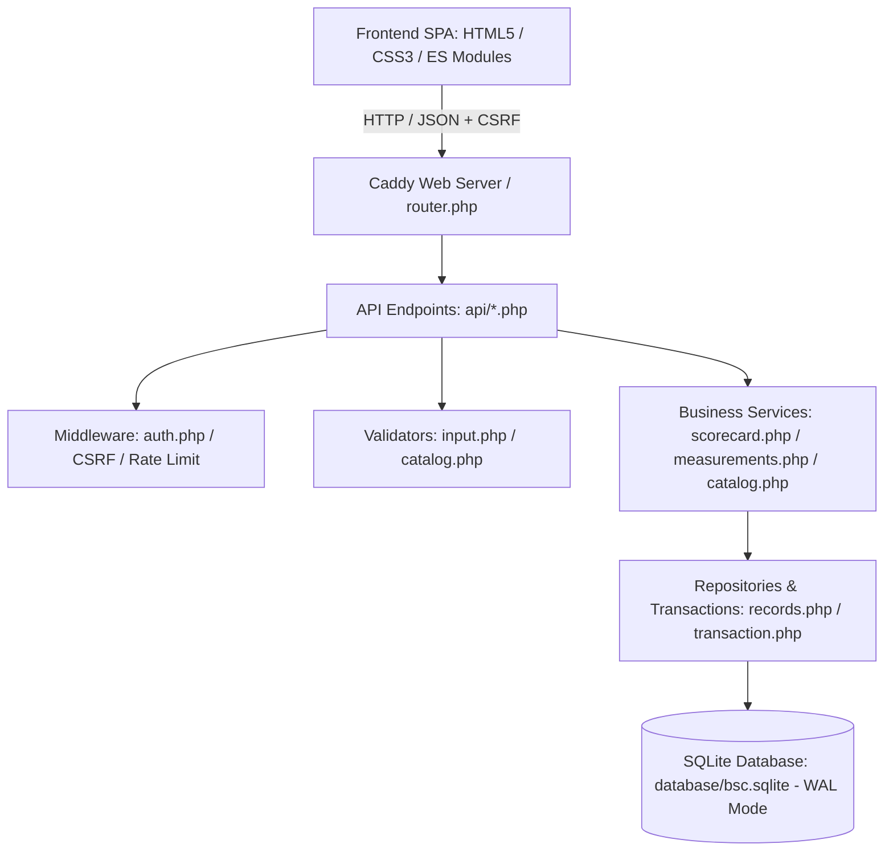

# Arquitectura del Sistema — TechPeru SAC BSC 2025

## 1. Visión General
El **Balanced Scorecard (BSC 2025) de TechPeru SAC** es una aplicación web empresarial orientada a la gestión estratégica y monitoreo de indicadores de desempeño en tiempo real. La arquitectura está diseñada siguiendo principios de bajo acoplamiento, alta cohesión y robustez transaccional (ACID).

## 2. Estructura de Capas

### A. Capa de Presentación (Frontend SPA)
- **`index.html`**: Punto de entrada único que orquesta la pantalla de acceso corporativo y el contenedor principal (`#appView`).
- **`js/app.js`**: Controlador de navegación por hash (`#dashboard`, `#mapa`, `#objetivos`, `#kpis`, `#mediciones`, `#iniciativas`, `#reportes`, `#administracion`), renderizado reactivo del DOM, modales y gráficos con Chart.js.
- **`js/api.js`**: Cliente HTTP ligero con gestión automática de cookies de sesión, cabeceras `X-CSRF-Token` y captura centralizada de errores.
- **`css/styles.css`**: Sistema de diseño basado en CSS Grid y variables nativas. Layout desacoplado con dos columnas reales (`268px minmax(0, 1fr)`) y comportamiento responsive optimizado.

### B. Capa de Enrutamiento y Servidor
- **`Caddyfile`**: Servidor de alto rendimiento con FrankenPHP/Caddy. Bloquea el acceso directo a bases de datos SQLite, archivos `.env`, directorios de código interno y archivos sensibles con respuesta `404 Not Found`.
- **`router.php`**: Enrutador seguro para el servidor de desarrollo PHP CLI (`php -S`) y contenedores Docker estándar.

### C. Capa de Controladores y Endpoints (`api/`)
- `api/auth.php`: Autenticación, sesión, logout, perfil y cambio seguro de contraseña.
- `api/dashboard.php`: Agregación ejecutiva de KPIs, objetivos y perspectivas.
- `api/objectives.php`: CRUD de objetivos estratégicos.
- `api/kpis.php`: CRUD de indicadores de desempeño.
- `api/measurements.php`: Captura periódica de valores reales y correcciones auditadas.
- `api/initiatives.php`: CRUD de planes de acción e iniciativas estratégicas.
- `api/reports.php`: Resúmenes ejecutivos, exportación a CSV sanitizado y reporte imprimible.
- `api/admin.php`: Gestión de usuarios, reseteo de claves, activación de períodos y auditoría.

### D. Capa de Lógica de Negocio (`services/`)
- `services/scorecard.php`: Motor de cálculo oficial del BSC (fórmulas directas/inversas, umbrales y manejo de KPIs sin mediciones).
- `services/measurements.php`: Lógica transaccional de registro y corrección de mediciones con preservación de valor histórico y registro de motivo.
- `services/catalog.php`: Operaciones de entidades maestras, sincronización de claves foráneas e integridad referencial.

### E. Capa de Validación y Seguridad (`validators/` & `middleware/`)
- `validators/input.php`: Saneamiento y validación tipada de enteros, flotantes, cadenas, fechas e identificadores.
- `middleware/auth.php`: Protección de sesión, verificación de roles (`requireRole`), validación de tokens anti-CSRF y rate limiting de login.

### F. Capa de Datos y Persistencia (`database/` & `repositories/`)
- `database/db.php`: Conexión PDO SQLite configurada con `PRAGMA journal_mode = WAL;` y `PRAGMA foreign_keys = ON;`.
- `database/schema.php`: Definición declarativa de las 9 tablas, índices y triggers.
- `database/migrations.php`: Migraciones aditivas idempotentes (V1 a V4).
- `repositories/records.php`: Abstracción de persistencia y registro inmutable en `activity_logs`.
