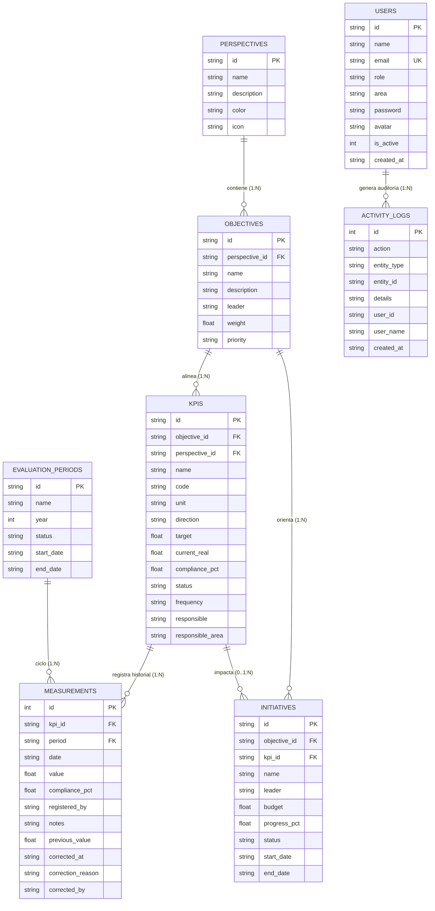

# Modelo de Datos e Integridad Referencial — TechPeru SAC

## 1. Diagrama Entidad-Relación

## 2. Restricciones e Índices

### Claves Foráneas (`PRAGMA foreign_keys = ON`)
- `kpis.objective_id` -> `objectives.id` ON DELETE CASCADE
- `kpis.perspective_id` -> `perspectives.id` ON UPDATE CASCADE
- `measurements.kpi_id` -> `kpis.id` ON DELETE CASCADE
- `initiatives.objective_id` -> `objectives.id` ON DELETE CASCADE
- `initiatives.kpi_id` -> `kpis.id` ON DELETE SET NULL

### Índices de Rendimiento
- `idx_kpis_objective`: Búsquedas agrupadas por objetivo.
- `idx_kpis_perspective`: Filtros por perspectiva estratégica.
- `idx_measurements_date`: Búsqueda de la medición más reciente por KPI (`kpi_id, date DESC, id DESC`).
- `idx_measurements_period`: Consultas y cortes por período (`period, date`).
- `idx_initiatives_objective`: Búsqueda de iniciativas por objetivo.

### Triggers de Integridad
- `measurement_duplicate`: Rechaza inserciones duplicadas si ya existe una medición para el mismo KPI, período y fecha.
